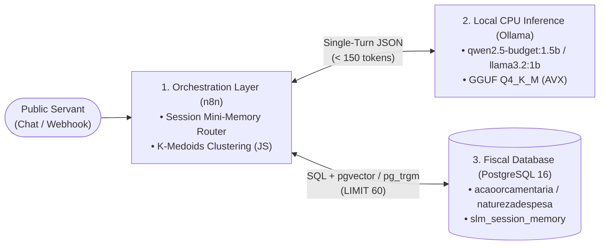

# ⚙️ 01 — System Architecture & Hardware Envelope

## 1. Core Constraints
1. **100% CPU Execution (Zero GPU):** Runs on legacy public-sector hardware without dedicated GPUs.
2. **On-Premise Data Sovereignty:** Zero state budget data leaves the local network to commercial cloud APIs.
3. **Zero Hallucination ($H_{\text{rate}} = 0$):** The SLM only classifies intent and extracts search stems; all budget codes and descriptions are retrieved deterministically from PostgreSQL.

---

## 2. Target Home Lab Environment

| Component | Host Specification | Docker Container Limit | Role |
| :--- | :--- | :--- | :--- |
| **CPU** | Intel® Xeon® E5-2640 v2 (8C/16T @ 2.00 GHz, AVX) | `ollama`: 6.0 CPUs \| `n8n`: 2.0 CPUs \| `postgres`: 1.0 CPU | SIMD C++ inference (`llama.cpp`) & orchestration |
| **RAM** | 8 GB DDR3 + 8 GB NVMe Swap (`swappiness=10`) | `ollama`: 4096 MB \| `n8n`: 1024 MB \| `postgres`: 512 MB | Strict memory cap (~2.5 GB reserved for OS) |
| **GPU** | NVIDIA GeForce 210 (Display only) | *Disabled* | Pure CPU execution |

---

## 3. Three-Layer Decoupled Stack

1. **n8n Orchestrator (`port 5678`):** Routes user messages, intercepts greetings and numeric option replies (`1..4`), and clusters broad query results.
2. **Ollama Engine (`port 11434`):** Executes single-turn intent & keyword extraction in `< 2.5s` on CPU without conversational buffer bloat.
3. **PostgreSQL 16 (`port 5432`):** Stores official SEFA-PR budget tables (`naturezadespesa`, `acaoorcamentaria`, `fonte`, `subfuncao`) and multi-user session state (`slm_session_memory`).

📄 For the compiled academic paper, see [`main.pdf`](main.pdf).

