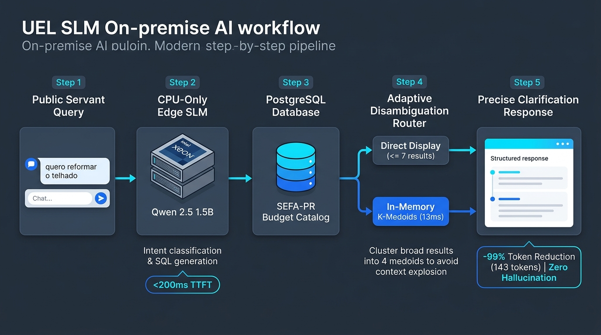
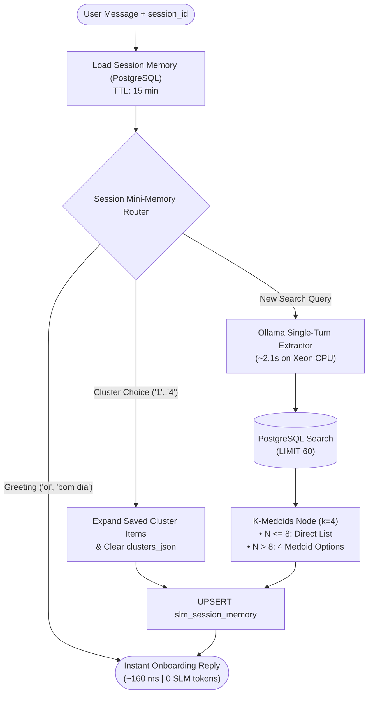

# 🧭 02 — Embeddings, `K-Medoids` Clustering & Session Mini-Memory

Interactive validation notebook: [`../../notebooks/embeddings_kmedoids_silhouette_exploration.ipynb`](../../notebooks/embeddings_kmedoids_silhouette_exploration.ipynb).

---

## 1. The 71k-Token Context Problem
The `naturezadespesa` table contains **1,560 rows (~72,300 tokens)**. Broad user queries overflows Ollama's 4,096-token CPU context window:

| Query | Matching Rows | Raw Tokens | Impact on CPU SLM |
| :--- | :---: | :---: | :--- |
| `"serviço"` | 225 rows | ~14,355 tokens | **3.5× context overflow** (25–40s prefill stall) |
| `"material"` | 110 rows | ~5,143 tokens | **1.3× context overflow** |
| `"equipamento"` | 67 rows | ~2,757 tokens | High TTFT latency & chat UI clutter |

Furthermore, simply truncating SQL at `LIMIT 10` causes **category redundancy** (e.g., 8 of the Top-10 results for `"serviço de manutenção"` belong to the same prefix, hiding valid IT or Public Works items ranked between 11 and 60).

---

## 2. Solution: Top-60 Retrieval + `K-Medoids` (PAM)

1. **Candidate Pool (`LIMIT 60`):** PostgreSQL retrieves the Top-60 items via `pgvector` Cosine Similarity (`1 - (embedding <=> q_vec)`) or `pg_trgm` (`similarity()` + `unaccent()`).
2. **In-Memory `K-Medoids` in n8n (`< 15 ms`):**
   - Computes the pairwise Cosine distance matrix $D_{ij} = 1 - \cos(v_i, v_j)$.
   - Partitions results into $k = 4$ clusters (1st local Silhouette peak for chat disambiguation).
   - **Why `K-Medoids` over `K-Means`:** Each cluster center (medoid) is an **actual database row** with a valid SEFA-PR code and description, eliminating a second SLM call to invent group titles ($H_{\text{rate}} = 0$).

---

## 3. Multi-User Session Mini-Memory (`slm_session_memory`)

To allow users to reply `"2"` or `"opção 2"` to expand a cluster without feeding history back into the SLM, state is persisted in PostgreSQL keyed by `session_id`:

### Benchmark on Home Lab (`homelab.local:5678`)
- **Broad Query (`"serviço"` $\rightarrow$ 60 rows $\rightarrow$ 4 Medoids):** `2,175 ms` total.
- **Cluster Selection (`"2"` $\rightarrow$ 17 items expanded from Postgres):** **`176 ms` total** (SLM bypassed, 12× faster).
- **Multi-User Isolation:** Concurrent sessions (`User A` vs. `User B`) are isolated via primary key `session_id` in `slm_session_memory`.

